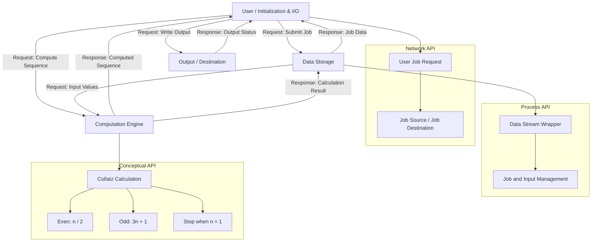

## Computation

The system will calculate the Collatz sequence for the input number. If the current number is even, the system will divide it by 2. If the number is odd, the system will multiply it by 3 and add 1. The system will continue this process until the number reaches 1.

For example, if the input is `6`, the computation will be:

**Sample Input:**
`6`

**Sample Output:**
`6, 3, 10, 5, 16, 8, 4, 2, 1`

This computation can be CPU intensive for larger input values because the system may need to perform many repeated calculations before reaching 1.

## System Architecture

